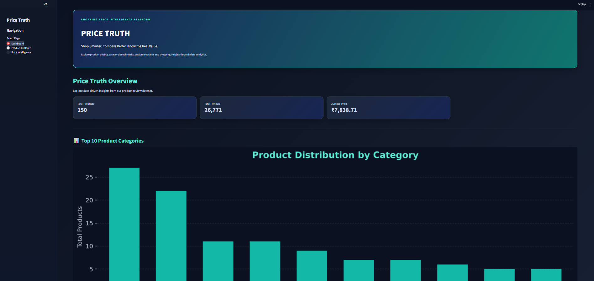
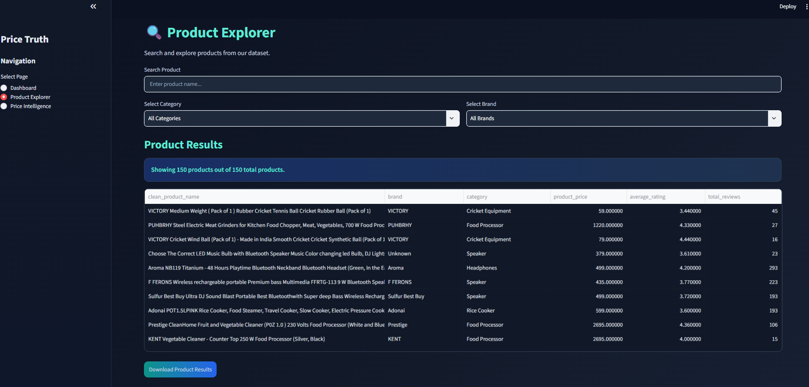

# 🛒 PRICE TRUTH
### Shopping Price Intelligence Platform

**Shop Smarter. Compare Better. Understand Product Value.**

Price Truth is a Data Science-based shopping price intelligence project that analyses product pricing, customer ratings, reviews, brands, and product categories to help users understand product value through data.

The project transforms raw shopping review data into meaningful insights using data cleaning, exploratory data analysis, product analytics, and category-based price benchmarking. It also provides an interactive dashboard built with Streamlit.

---

## 📌 Project Overview

Online shopping offers thousands of products, but understanding whether a product is reasonably priced can be difficult.

Price Truth aims to make shopping data easier to understand by analysing product prices, ratings, customer reviews, and category-level pricing patterns.

The platform currently uses a product review dataset to generate analytical insights and compare individual product prices against their respective category median prices.

> **Project Type:** Data Science | Data Analytics | Python | Streamlit  
> **Development Status:** Core Analytics & Dashboard Completed  
> **Developed By:** Undergraduate Computer Science & Artificial Intelligence Student

---

## 🎯 Project Objectives

- Analyse product prices and customer ratings.
- Clean and preprocess raw shopping datasets.
- Identify brands and product categories.
- Understand customer review and sentiment distributions.
- Generate product-level and category-level analytics.
- Compare product prices with category median benchmarks.
- Identify products priced below, near, or above their category benchmark.
- Build an interactive dashboard for exploring shopping insights.

---

## ✨ Key Features

### 1. Data Cleaning & Preprocessing
- Handles missing values.
- Removes exact duplicate records.
- Validates product prices and ratings.
- Generates a clean dataset for further analysis.

### 2. Exploratory Data Analysis (EDA)
- Product price distribution.
- Customer rating distribution.
- Customer sentiment distribution.
- Most-reviewed products.
- Visual representation of important dataset patterns.

### 3. Product Intelligence
- Product name cleaning.
- Brand identification.
- Product category classification.
- Capacity and wattage extraction.
- Product catalogue generation.

### 4. Product Analytics
- Average product ratings.
- Product-level price statistics.
- Brand performance analysis.
- Category performance analysis.
- Review count analysis.

### 5. Price Intelligence Engine
- Calculates category median prices.
- Measures percentage differences from category benchmarks.
- Classifies product prices into three groups:

| Price Position | Meaning |
|---|---|
| Below Category Benchmark | Price is more than 10% below the category median. |
| Near Category Benchmark | Price is within approximately 10% of the category median. |
| Above Category Benchmark | Price is more than 10% above the category median. |

### 6. Interactive Streamlit Dashboard
- Product exploration.
- Search by product name.
- Brand and category filters.
- Product pricing insights.
- Category performance visualizations.
- Interactive data tables.
- CSV report downloads.
- Dark-themed dashboard interface.

---

## 🧰 Technology Stack

| Technology | Purpose |
|---|---|
| Python | Core programming language |
| Pandas | Data manipulation and analysis |
| NumPy | Numerical operations |
| Matplotlib | Data visualization |
| Seaborn | Statistical visualization |
| Plotly | Interactive visualization library |
| Scikit-learn | Machine learning library for future extensions |
| PyArrow | Parquet dataset support |
| Streamlit | Interactive web dashboard |
| Jupyter Notebook | Data exploration and experimentation |
| Git & GitHub | Version control and project management |

---

## 📂 Project Structure

text
PriceTruth/
│
├── data/
│   ├── raw/
│   │   └── train.parquet
│   │
│   └── processed/
│       └── cleaned_flipkart_reviews.parquet
│
├── notebooks/
│
├── src/
│   ├── preprocessing/
│   │   └── clean_data.py
│   │
│   ├── analytics/
│   │   ├── product_analysis.py
│   │   ├── data_quality_report.py
│   │   ├── price_intelligence.py
│   │   └── price_visualization.py
│   │
│   └── matching/
│       ├── inspect_products.py
│       └── extract_attributes.py
│
├── dashboard/
│   └── app.py
│
├── models/
│
├── reports/
│   ├── figures/
│   ├── product_catalog.csv
│   ├── brand_analysis.csv
│   ├── category_analysis.csv
│   ├── price_intelligence.csv
│   └── data_quality_report.csv
│
├── tests/
│
├── requirements.txt
├── README.md
└── .gitignore

---

## 📊 Dataset Information

The project uses the Flipkart Reviews Dataset available through Hugging Face.

**Dataset:** `ml-hub/flipkart-reviews-dataset`

### Original Dataset

| Attribute | Value |
|---|---:|
| Total Records | 30,000 |
| Total Columns | 7 |
| Product Information | Available |
| Customer Ratings | Available |
| Customer Reviews | Available |
| Sentiment Labels | Available |

### Dataset Columns

| Column | Description |
|---|---|
| product_name | Product name |
| product_price | Product price |
| Rate | Customer rating |
| Review | Review title |
| text | Customer review text |
| labels | Sentiment label |
| sentiment_code | Numerical sentiment representation |

---

## 🧹 Data Preprocessing Results

The original dataset was processed to improve data quality.

| Processing Stage | Records |
|---|---:|
| Original Dataset | 30,000 |
| After Missing Value Removal | 29,999 |
| After Exact Duplicate Removal | 26,771 |
| Final Cleaned Dataset | 26,771 |

### Data Quality Checks

- Missing values: 0
- Exact duplicate records: 0
- Invalid product prices: 0
- Invalid customer ratings: 0
- Data quality checks passed: 5/5
- Data quality score: 100%

---

## 📈 Analytical Results

### Product Dataset Statistics

| Metric | Result |
|---|---:|
| Cleaned Records | 26,771 |
| Unique Products | 150 |
| Unique Brand Values | 83 |
| Product Categories | 26 |
| Average Product Rating | 4.05 / 5 |
| Average Product Price | ₹6,898.37 |

### Customer Sentiment Distribution

| Sentiment | Records |
|---|---:|
| Positive | 21,260 |
| Negative | 4,178 |
| Neutral | 1,333 |

### Product Price Position

| Price Position | Products |
|---|---:|
| Below Category Benchmark | 41 |
| Near Category Benchmark | 61 |
| Above Category Benchmark | 48 |

**Total analysed products: 150**

These results are generated from the cleaned dataset and the project's analytical pipeline.

---

## ⚙️ How Price Intelligence Works

The Price Intelligence Engine follows these steps:

1. Loads the cleaned product dataset.
2. Normalizes product names.
3. Connects products with extracted brand and category information.
4. Calculates product-level pricing and rating metrics.
5. Calculates the median price for each category.
6. Compares individual product prices with their category median.
7. Calculates percentage price differences.
8. Assigns a price position to each product.
9. Exports the results into a CSV report.

### Price Difference Formula

python
price_difference_percent = (
    (product_price - category_median_price)
    / category_median_price
) * 100

This calculation helps identify how a product's price compares with its category benchmark.

---

## 🖥️ Dashboard Preview

The Price Truth dashboard provides an interactive interface to explore product pricing, customer ratings, and shopping analytics.

### 1. Dashboard Overview

The main dashboard displays key project statistics and category-level insights.

### 2. Product Explorer

Explore products using search, brand filters, and category filters. Users can also download filtered product results as CSV files.

### Dashboard Features

- Interactive KPI Cards
- Product Search and Filtering
- Price Intelligence Analysis
- Category Performance Visualization
- Product Data Tables
- CSV Report Downloads

---

## 🚀 Installation & Setup

Follow these steps to run Price Truth locally.

### 1. Clone the Repository

bash
git clone https://github.com/Ravindrasain131204/PriceTruth.git

### 2. Open the Project Directory

bash
cd PriceTruth

### 3. Create a Virtual Environment

bash
python -m venv venv

### 4. Activate the Virtual Environment

**Windows PowerShell:**

powershell
.\venv\Scripts\Activate.ps1

### 5. Install Dependencies

bash
pip install -r requirements.txt

### 6. Run the Dashboard

bash
python -m streamlit run dashboard/app.py

The dashboard will open in your browser at:

text
http://localhost:8501

**Note:** The raw dataset and processed dataset are required for the complete workflow. Make sure the required data files are available in their respective directories.

---

## 🔮 Future Improvements

Price Truth is designed to grow into a more advanced shopping intelligence platform.

Planned improvements include:

- Multi-retailer product price comparison.
- Historical price tracking using timestamped observations.
- Price trend visualization.
- Machine learning-based price prediction.
- Discount and unusual price change detection.
- Product recommendation system.
- Buy Now / Wait recommendations.
- Automated price alerts.
- Product matching across shopping platforms.
- API integration for external applications.

These features are planned extensions and are not part of the currently completed implementation.

---

## ⚠️ Current Limitations

Transparency is an important part of data science.

- The current dataset does not contain historical price timestamps.
- It does not provide verified seller or retailer information.
- The current price benchmark is based on category median prices within the available dataset.
- A price below the category median does not automatically mean a genuine discount.
- The dataset contains imperfect product names, so brand and category extraction uses rule-based matching.
- Price forecasting and real-time retailer comparison require additional suitable data sources.

---

## 👨‍💻 About the Developer

**Ravindra Kumar**

Undergraduate Student — B.Sc. Computer Science and Artificial Intelligence

Interested in Data Science, Artificial Intelligence, Machine Learning, and building practical software solutions.

This project is part of my journey to develop practical data science skills through real-world datasets, analytical problem-solving, Python programming, and interactive applications.

### Connect

- GitHub: [@Ravindrasain131204](https://github.com/Ravindrasain131204)
- Project Repository: [Price Truth](https://github.com/Ravindrasain131204/PriceTruth)

---

## ⭐ Support

If you find this project interesting, consider giving the repository a star on GitHub.

**Price Truth — Making Shopping Data More Meaningful.**

### Abhi kya karna hai?

1. README mein poora content paste karke save karo.
2. PowerShell mein run karo:

powershell
Get-Content README.md

Bas confirm karna ki file properly save hui hai. Uske baad hum README ke liye **actual dashboard screenshots** add karenge, jisse GitHub profile par project aur professional dikhega.